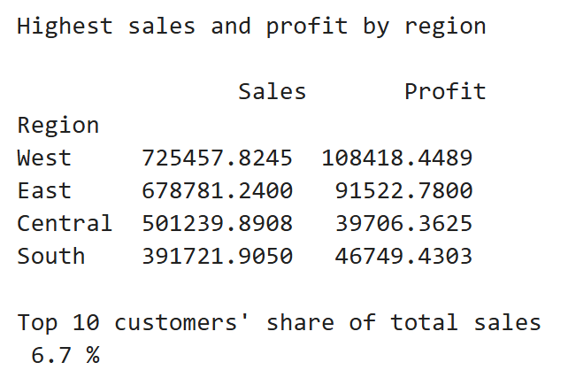
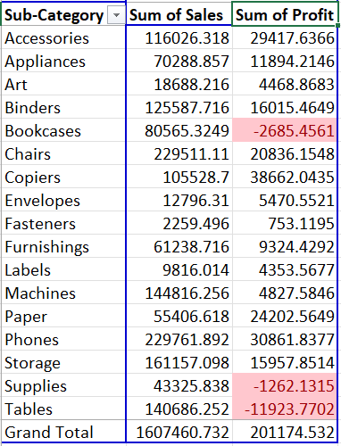

# Superstore Sales Analysis & Automated Reporting

A Python project that cleans, validates and analyzes retail sales data, then generates Excel reports automatically for any region with a single function call.


---

## Project Overview

Business teams often rebuild the same sales reports by hand every month. This project replaces that manual work with a repeatable pipeline: load the raw data, clean it, check that it is reliable, analyze it, and export a formatted Excel report.

**Dataset:** Superstore sales data (orders, customers, products, regions, sales, profit and discount).

## Key Features

- **Data cleaning:** standardized column names, converted dates (`dd-mm-yyyy`) to datetime, removed duplicate rows
- **Data validation:** confirmed Ship Date is never before Order Date and flagged loss-making rows
- **Exploratory analysis:** sales and profit by region and category, monthly sales trend, top customers, loss-making sub-categories
- **Automated reporting:** `generate_report(data, Region)` creates a 5-sheet Excel report for all regions or one selected region

  

## Tools & Technologies

| Area | Tools |
|------|-------|
| Language | Python |
| Data analysis | pandas |
| Excel export | openpyxl |
| Environment | Jupyter Notebook |

## Project Structure

```
Python_Analysis/
├── data/
│   └── superstore.csv
├── outputs/
│   ├── sales_report_All.xlsx
│   └── sales_report_West.xlsx
├── sales_report.ipynb
└── README.md
```

## Workflow

1. **Load** the CSV file (`latin-1` encoding for special characters)
2. **Inspect** data types, missing values, duplicates and summary statistics
3. **Clean** column names, dates and duplicate rows
4. **Validate** date logic and profit values
5. **Analyze** sales and profit trends
6. **Report** export results to Excel using a reusable function

## Key Insights

> Replace the points below with your own findings from the notebook.

- **Regional performance:**  **West** has the highest sales and profit, while **Central** has the lowest profit margin.
- **Seasonality:** Sales peak in **November** and are lowest in **february**.
- **Customers:** The top 10 customers contribute **6.7%** of total sales.
- **Loss-making products:** **Bookcases** , **Supplies** and **Tables** generate losses and need a pricing or discount review.

    
    

## Automated Report

The report function produces an Excel file with four sheets:

| Sheet | Content |
|-------|---------|
| Summary | Total sales, total profit, number of orders, profit margin % |
| By Category | Sales and profit for each product category |
| Monthly Sales | Sales trend by month |
| Top Customers | Top 10 customers by sales |

**Example usage:**

```python
generate_report(df)            # report for all regions
generate_report(df, "West")    # report for one region
```

The same code can produce a report for any region, which makes it easy to replicate reporting for new markets.

## How to Run

1. Clone or download this repository.
2. Install the requirements:
   ```bash
   pip install pandas openpyxl jupyter
   ```
3. Place `superstore.csv` in the `data/` folder.
4. Open `sales_report.ipynb` and choose **Kernel → Restart & Run All**.
5. Find the generated reports in the `outputs/` folder.

## Skills Demonstrated

Data cleaning, data validation, exploratory data analysis, grouping and aggregation, report automation, writing reusable functions, and communicating insights.

## Author

**Aniket Singh**
Data Analyst | SQL, Python, Power BI, Tableau, Excel

[LinkedIn](#) | [GitHub](#) | aniketksingh60@gmail.com
